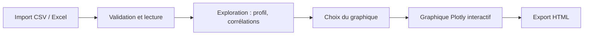

<div align="center">

# GraphGen

**Transformez un fichier CSV ou Excel en analyse exploratoire et en graphiques interactifs, sans écrire une ligne de code.**

[](https://github.com/Chaymae-El-Bahloul/GraphGen/actions)


[](LICENSE)

[Démo en ligne](#) · [Démarrage rapide](#démarrage-rapide) · [Fonctionnalités](#fonctionnalités) · [Contribuer](#contribuer)

</div>

<!-- Ajoutez ici une capture d'écran ou un GIF de l'application :
<p align="center"></p>
-->

## Sommaire

- [Pourquoi GraphGen ?](#pourquoi-graphgen-)
- [Fonctionnalités](#fonctionnalités)
- [Comment ça marche](#comment-ça-marche)
- [Démarrage rapide](#démarrage-rapide)
- [Utilisation](#utilisation)
- [Stack technique](#stack-technique)
- [Architecture](#architecture)
- [Configuration](#configuration)
- [Qualité et sécurité](#qualité-et-sécurité)
- [Déploiement](#déploiement)
- [Contribuer](#contribuer)
- [Feuille de route](#feuille-de-route)
- [Auteures](#auteures)
- [Licence](#licence)

## Pourquoi GraphGen ?

Explorer un fichier de données demande souvent du code ou un outil lourd. **GraphGen** permet à n'importe qui d'importer un fichier, de comprendre sa qualité (valeurs manquantes, doublons, corrélations) et de produire des graphiques interactifs en quelques clics.

**Pour qui ?** Étudiants, analystes débutants ou toute personne qui veut un premier regard rapide sur un jeu de données avant d'aller plus loin.

## Fonctionnalités

| Catégorie | Détails |
|---|---|
| **Import** | `.csv` et `.xlsx` multi-feuilles (10 Mo max), glisser-déposer, jeu de données de démonstration intégré |
| **Détection automatique** | Séparateur CSV, encodage et **ligne d'en-tête Excel** (ignore les lignes de titre) |
| **Exploration** | Indicateurs clés (lignes, colonnes, % de manquants, doublons), **profil de chaque colonne**, **matrice de corrélation** |
| **Visualisation** | 6 types de graphiques : ligne, barres, nuage de points, histogramme, boîte à moustaches, camembert |
| **Agrégations** | Somme, moyenne, nombre, minimum, maximum, avec regroupement par couleur |
| **Personnalisation** | 5 palettes, titre libre, **export HTML interactif** |
| **Interface** | Responsive, mode sombre automatique |

## Comment ça marche



## Démarrage rapide

### Prérequis

- Python 3.10 ou plus récent
- Git

### Installation

```bash
git clone https://github.com/Chaymae-El-Bahloul/GraphGen.git
cd GraphGen
python -m venv .venv
```

Activez ensuite l'environnement virtuel selon votre système :

| Système | Commande |
|---|---|
| Windows (PowerShell) | `.venv\Scripts\Activate.ps1` |
| Windows (cmd) | `.venv\Scripts\activate.bat` |
| Linux / macOS | `source .venv/bin/activate` |

> Sous PowerShell, si l'activation est bloquée, exécutez une fois : `Set-ExecutionPolicy -Scope CurrentUser RemoteSigned`.

Puis installez les dépendances et lancez l'application :

```bash
pip install -r requirements.txt
python app.py
```

Ouvrez <http://127.0.0.1:5000>, puis cliquez sur **« Essayer avec un jeu de données de démo »**.

### Avec Docker

```bash
docker build -t graphgen .
docker run -p 8000:8000 -e SECRET_KEY=change-me graphgen
```

L'application est alors disponible sur <http://localhost:8000>.

## Utilisation

1. **Importez** un fichier `.csv` ou `.xlsx` (ou lancez le jeu de démonstration).
2. **Explorez** l'aperçu : indicateurs clés, profil de chaque colonne et matrice de corrélation.
3. **Choisissez** un type de graphique, les colonnes à tracer, l'agrégation et la palette.
4. **Exportez** le résultat en HTML interactif pour le partager ou l'intégrer ailleurs.

## Stack technique

| Couche | Technologies |
|---|---|
| Backend | Python, Flask, Gunicorn |
| Données | pandas, openpyxl |
| Visualisation | Plotly |
| Frontend | Jinja2, HTML, CSS (thème clair / sombre) |
| Qualité | pytest, ruff, GitHub Actions |
| Déploiement | Docker, Procfile (Render / Railway) |

## Architecture

```text
GraphGen/
├── app.py              # Routes Flask, sécurité, configuration
├── helpers.py          # Chargement, profilage, corrélations, graphiques
├── templates/          # Pages Jinja2 : base, index, preview, chart
├── static/style.css    # Thème clair / sombre, responsive
├── sample_data/        # Jeu de démonstration synthétique
├── tests/              # Tests pytest
├── Dockerfile · Procfile · pyproject.toml
└── .github/workflows/ci.yml
```

## Configuration

| Variable | Rôle | Défaut |
|---|---|---|
| `SECRET_KEY` | Clé de session Flask (**à définir en production**) | valeur de développement |
| `UPLOAD_TTL_HOURS` | Durée de conservation des fichiers importés | `24` |
| `FLASK_DEBUG` | `1` pour activer le mode debug en local | désactivé |

## Qualité et sécurité

- Fichiers stockés sous **identifiant aléatoire** (pas de path traversal), extensions validées, taille limitée.
- **Suppression automatique** des fichiers importés après 24 h.
- En-têtes de sécurité HTTP, route de santé `/health`, logs structurés.
- **12 tests automatisés avec pytest**, vérification du code avec `ruff` et intégration continue via GitHub Actions.
- Conteneur Docker non-root avec healthcheck.

Pour lancer les vérifications en local :

```bash
pip install -r requirements-dev.txt
ruff check .
pytest
```

## Déploiement

Sur Render ou Railway :

1. **Build** : `pip install -r requirements.txt`
2. **Démarrage** : `gunicorn "app:create_app()"` (voir le `Procfile`)
3. **Variable d'environnement** : définir `SECRET_KEY` avec une valeur secrète et unique.

## Contribuer

Les contributions sont les bienvenues. Le workflow recommandé :

```bash
git checkout -b feature/ma-fonctionnalite
# ... modifications ...
ruff check . && pytest
git add .
git commit -m "Ajoute ma fonctionnalité"
git push -u origin feature/ma-fonctionnalite
```

Ouvrez ensuite une **Pull Request** vers `main` : la CI doit passer avant la fusion.

## Feuille de route

- [x] Import CSV / Excel multi-feuilles
- [x] Profilage des colonnes et corrélations
- [x] 6 types de graphiques, agrégations, export HTML
- [x] Tests, CI, Docker
- [ ] Export PNG
- [ ] Filtres sur les données
- [ ] Graphiques multi-séries
- [ ] Authentification

## Auteures

Projet réalisé par :

- **Chaymae El Bahloul** : [GitHub](https://github.com/Chaymae-El-Bahloul) · [LinkedIn](https://www.linkedin.com/in/chaymae-el-bahloul)
- **Samah Boudallaa** : [GitHub](https://github.com/Samah-boudallaa) · [LinkedIn](https://www.linkedin.com/in/samah-boudallaa-92409a329)

Étudiantes en Data Science.

## Licence

Distribué sous licence MIT. Voir le fichier [LICENSE](LICENSE).